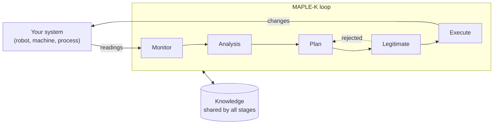

# RoboSAPIENS Adaptive Platform (RAP)

[](https://python.org)
[](https://pypi.org/project/rpclpy/)

RAP helps you make a system **self-adaptive**: it watches itself while running, notices when something is wrong, and changes its own behaviour safely, without a person stepping in.

**rpclpy** is its Python library. You write the logic for your use case, and rpclpy provides the rest:

- the communication between the parts of your adaptation loop
- a shared store for what they know
- a dashboard to watch it run
- an easier way to connect the [Trustworthiness Checker](https://github.com/INTO-CPS-Association/robosapiens-trustworthiness-checker), which checks at runtime that your system keeps to the rules you set

RAP is developed in the [RoboSAPIENS](https://robosapiens-eu.tech/) project, a European research initiative on trustworthy self-adaptive robotic systems.

## The MAPLE-K loop

Every system built with RAP follows the same loop.



| Stage | Question it answers | Example: a pump |
|---|---|---|
| **Monitor** | What is happening? | Store the latest pressure |
| **Analysis** | Is something wrong? | Is the pressure over the limit? |
| **Plan** | What could we do about it? | Propose a lower speed |
| **Legitimate** | Is that change safe? | Is the new speed within the allowed range? |
| **Execute** | Apply it. | Send the new speed to the pump |
| **Knowledge** | What do the stages share? | Latest pressure, proposed speed |

Each stage is a **node**: a small Python class. Nodes never call each other. A node finishes its work, writes what it learned to Knowledge, and publishes an **event** that wakes up the next node. This means you can run them all in one process while developing, then move them to separate processes or machines without changing their code.

## Build your first self-adaptive system

You will build the pump from the table above. Its pressure is too high at the start, and the loop brings it back under the limit. You only need Python 3.10 or newer, and no other software for the first part.

### 1. Install

```bash
mkdir my-pump && cd my-pump
python -m venv .venv
source .venv/bin/activate     # Windows: .venv\Scripts\activate
pip install rpclpy
```

### 2. Map your use case to the stages

Before writing code, fill in the table above for your own system, and answer two more questions:

- **What does your system publish?** Here, an event called `PumpStatus` with the pressure and speed.
- **What must stages remember or share?** Each answer becomes a Knowledge class.

If you can't say what Legitimate checks, stop and decide. That check is what makes the adaptation safe.

### 3. Define what the stages share

Knowledge classes go in their own file, because they are stored with pickle and other processes need to be able to import them.

**`pump_messages.py`**

```python
class PumpState:
    def __init__(self):
        self.name = "PumpState"  # its key in the Knowledge store
        self.uid = None          # uid and timestamp are filled in by rpclpy
        self.timestamp = None
        self.pressure = 0.0
        self.speed = 0.0


class SpeedPlan:
    def __init__(self):
        self.name = "SpeedPlan"
        self.uid = None
        self.timestamp = None
        self.speed = 0.0
```

### 4. Write the five stages

Each node does the same three things: reads Knowledge, does its work, then writes Knowledge and publishes an event. The `Pump` class stands in for your real system.

**`pump_loop.py`**

```python
import json
import sys
import time

import yaml

from rpclpy.node import Node
from rpclpy.utils import timeit_callback
from pump_messages import PumpState, SpeedPlan

PRESSURE_LIMIT = 8.0
MIN_SPEED, MAX_SPEED = 20.0, 150.0


class Monitor(Node):
    def __init__(self, config):
        super().__init__(config)
        # Give Knowledge a starting value, so later reads always find something.
        self.write_knowledge(PumpState())
        self.write_knowledge(SpeedPlan())

    def register_callbacks(self):
        self.register_event_callback("PumpStatus", self.monitor)

    @timeit_callback
    def monitor(self, msg):
        status = json.loads(msg)  # events always arrive as a JSON string
        state = self.read_knowledge(PumpState)
        state.pressure, state.speed = status["pressure"], status["speed"]
        self.write_knowledge(state)
        print(f"Monitor:    pressure {state.pressure}, speed {state.speed}")
        self.publish_event("new_data")  # write first, publish last


class Analysis(Node):
    def register_callbacks(self):
        self.register_event_callback("new_data", self.analyse)

    @timeit_callback
    def analyse(self, msg):
        state = self.read_knowledge(PumpState)
        if state.pressure > PRESSURE_LIMIT:
            print(f"Analysis:   {state.pressure} is over the limit of {PRESSURE_LIMIT}")
            self.publish_event("anomaly")


class Plan(Node):
    def register_callbacks(self):
        self.register_event_callback("anomaly", self.plan)

    @timeit_callback
    def plan(self, msg):
        state = self.read_knowledge(PumpState)
        plan = SpeedPlan()
        plan.speed = round(state.speed * 0.8, 2)
        self.write_knowledge(plan)
        print(f"Plan:       propose speed {plan.speed}")
        self.publish_event("new_plan")


class Legitimate(Node):
    def register_callbacks(self):
        self.register_event_callback("new_plan", self.check)

    @timeit_callback
    def check(self, msg):
        plan = self.read_knowledge(SpeedPlan)
        if MIN_SPEED <= plan.speed <= MAX_SPEED:
            print(f"Legitimate: speed {plan.speed} is safe")
            self.publish_event("isLegit")
        else:
            print(f"Legitimate: speed {plan.speed} rejected")


class Execute(Node):
    def register_callbacks(self):
        self.register_event_callback("isLegit", self.execute)

    @timeit_callback
    def execute(self, msg):
        plan = self.read_knowledge(SpeedPlan)
        print(f"Execute:    set speed to {plan.speed}")
        self.publish_event("set_speed", {"speed": plan.speed})


class Pump(Node):
    """A simulated pump. Replace this with your real system."""

    def __init__(self, config):
        super().__init__(config)
        self.speed = 100.0

    def register_callbacks(self):
        self.register_event_callback("set_speed", self.on_set_speed)

    def on_set_speed(self, msg):
        self.speed = json.loads(msg)["speed"]

    def report(self):
        self.publish_event("PumpStatus", {"pressure": round(self.speed * 0.1, 2), "speed": self.speed})


def main():
    config_file = sys.argv[1] if len(sys.argv) > 1 else "config.yaml"
    steps = int(sys.argv[2]) if len(sys.argv) > 2 else 4
    with open(config_file) as f:
        config = yaml.safe_load(f)

    # Monitor comes first, because it fills in the starting Knowledge.
    nodes = [cls(config) for cls in (Monitor, Analysis, Plan, Legitimate, Execute, Pump)]
    for node in nodes:
        node.register_callbacks()  # always before start()
        node.start()

    pump = nodes[-1]
    for _ in range(steps):
        pump.report()
        time.sleep(1)

    for node in nodes:
        node.shutdown()


if __name__ == "__main__":
    main()
```

### 5. Configure and run

The config says how nodes talk to each other. `local` keeps everything inside one Python process.

**`config.yaml`**

```yaml
Logger_Config:
  log_level: WARNING
  logger_type: terminal
  format: "%(name)s: %(message)s"
Event_Manager_Config:
  protocol: local
Message_Manager_Config:
  protocol: local
Knowledge_Config:
  knowledge_type: local
```

```bash
python pump_loop.py
```

```text
Monitor:    pressure 10.0, speed 100.0
Analysis:   10.0 is over the limit of 8.0
Plan:       propose speed 80.0
Legitimate: speed 80.0 is safe
Execute:    set speed to 80.0
Monitor:    pressure 8.0, speed 80.0
Monitor:    pressure 8.0, speed 80.0
Monitor:    pressure 8.0, speed 80.0
```

That is a complete self-adaptive loop. The pressure was too high, so the system changed its own speed, and from then on Monitor sees normal readings and nothing else fires.

**To adapt this to your use case**, replace `Pump` with your system, change the Knowledge classes, and put your own logic in each callback. If planning is slow, such as training a model, run it in a `threading.Thread` started from the callback, so the node keeps receiving events.

### 6. Move to Redis

To run stages in separate processes or on separate machines, they need a shared service. [Install Redis](https://redis.io/docs/latest/operate/oss_and_stack/install/install-redis/), or use Docker:

```bash
docker run --name redis-server -p 6379:6379 -d redis
```

Only the config changes:

**`config_redis.yaml`**

```yaml
Logger_Config:
  log_level: WARNING
  logger_type: terminal
  format: "%(name)s: %(message)s"
Event_Manager_Config:
  protocol: redis
  host: localhost
  port: 6379
Message_Manager_Config:
  protocol: redis
  host: localhost
  port: 6379
Knowledge_Config:
  knowledge_type: redis
  host: localhost
  port: 6379
  db: 0
```

```bash
python pump_loop.py config_redis.yaml
```

The output is the same as before, plus a few `Redis listener thread exiting` lines at the end. These are normal when nodes shut down.

### 7. Check it at runtime with the Trustworthiness Checker

Adaptation code can have bugs too. The [Trustworthiness Checker](https://github.com/INTO-CPS-Association/robosapiens-trustworthiness-checker) (TC) watches your running system and reports when a rule you wrote is broken, and the rpclpy dashboard shows each rule as a live green or red row. This step needs Redis, from step 6.

**Build the checker** once, which needs [Rust](https://rustup.rs/). On Windows, the simplest way to run it is inside WSL.

```bash
git clone https://github.com/INTO-CPS-Association/robosapiens-trustworthiness-checker.git
cd robosapiens-trustworthiness-checker
cargo build --profile dev-fast
cd -
```

The program is now at `robosapiens-trustworthiness-checker/target/dev-fast/trustworthiness_checker`.

**Install the dashboard and the bridge template.** The bridge passes your events to the checker at a steady rate.

```bash
pip install "rpclpy[dashboard]"
rpio-skills install
cp .claude/skills/tc-integrate/assets/tc_bridge_template.py tc_bridge.py
```

In `tc_bridge.py`, replace the `EVENTS` and `KNOWLEDGE` tables with these. The values also set the types: `0.0` means a float.

```python
EVENTS = {
    "PumpStatus": {"uid": "", "pressure": 0.0, "speed": 0.0},
    "set_speed": {"uid": "", "speed": 0.0},
}

KNOWLEDGE = {}
```

**Write your rules.** Each `out` is one rule, and it is `true` when the rule is **broken**. The comment becomes its label on the dashboard. The pressure rule here is deliberately strict, so you can see it fire on the pump's first reading of 10.0.

**`pump.dsrv`**

```text
in PumpStatus: Struct<uid: Str, pressure: Float, speed: Float>
in set_speed: Struct<uid: Str, speed: Float>

aux hard_limit: Float
aux min_speed: Float
aux max_speed: Float
aux status_new: Bool
aux command_new: Bool

out v_overpressure: Bool  // P1 pressure stays below the hard limit
out v_unsafe_speed: Bool  // P2 commanded speed is in the safe range
out violation: Bool

hard_limit = 9.0
min_speed = 20.0
max_speed = 150.0

// The bridge repeats the latest value, so a new uid means a new event.
status_new = default(!(PumpStatus.uid == default(PumpStatus[1].uid, "")), false)
command_new = default(!(set_speed.uid == default(set_speed[1].uid, "")), false)

v_overpressure = status_new && PumpStatus.pressure > hard_limit
v_unsafe_speed = command_new && (set_speed.speed < min_speed || set_speed.speed > max_speed)
violation = v_overpressure || v_unsafe_speed
```

**Connect the rules to the bridge's channels:**

**`pump_redis_input.json5`**

```json5
{ PumpStatus: "tc:PumpStatus", set_speed: "tc:set_speed" }
```

**Add the dashboard:**

**`dashboard.py`**

```python
from rpclpy.DashboardApp import run_dashboard

run_dashboard(host="127.0.0.1", port=8050, debug=False, tc_spec_file="pump.dsrv")
```

**Run everything**, with one terminal for each command and Redis already running:

```bash
python tc_bridge.py
robosapiens-trustworthiness-checker/target/dev-fast/trustworthiness_checker pump.dsrv --input-redis-file pump_redis_input.json5 --redis-output --runtime async
python dashboard.py
python pump_loop.py config_redis.yaml 60
```

Keep `--runtime async`: without it, current checker versions run but publish nothing, so the dashboard stays gray.

Open http://127.0.0.1:8050. P1 turns red on the first reading of 10.0 and returns to green once the loop has lowered the speed. P2 stays green. A row turns gray if the checker stops sending values for that rule, so treat gray as a problem to look into, not as a pass.

## Let Claude Code do the work

If you use [Claude Code](https://code.claude.com/docs), rpclpy includes skills that carry out these steps on your own code:

```bash
rpio-skills install          # into this project's .claude/skills
rpio-skills install --user   # or for all your projects
```

Run `rpio-skills install --force` again after upgrading rpclpy, to keep the skills in step with the library.

| Skill | What it does |
|---|---|
| `rpclpy-port` | Turns your existing script, controller or notebook into MAPLE-K nodes, then checks them against the rpclpy API |
| `tc-properties` | Suggests rules worth monitoring for your system and writes them as a checker spec |
| `tc-integrate` | Connects a spec to your code: bridge, channels and dashboard. It also finds where spec and code have drifted apart |

## API reference

| Method | What it does |
|---|---|
| `Node(config)` | Create a node from a config dictionary |
| `node.register_event_callback(topic, fn)` | Run `fn(msg)` when an event arrives. Call it before `start()` |
| `node.start()` / `node.shutdown()` | Start or stop the node |
| `node.publish_event(topic, data)` | Publish an event, with an optional dictionary of data |
| `node.publish_message(topic, data)` | Publish on the separate message channel |
| `node.register_message_callback(topic, fn)` | Run `fn(msg)` when a message arrives |
| `node.write_knowledge(obj)` | Store a Knowledge object under its `name` |
| `node.read_knowledge(Cls)` | Get a copy of the stored object, or `None` if it was never written |
| `node.write_knowledge("key", value)` | Store a plain string or number |
| `node.read_knowledge("key")` | Read a plain value |
| `@timeit_callback` | Record how long a callback takes, for the dashboard's timeline |

### Installing extras

The default install covers Redis and the `local` mode. Add others as you need them:

```bash
pip install "rpclpy[dashboard]"   # web dashboard
pip install "rpclpy[mqtt]"        # also: kafka, rabbitmq, websocket, zenoh
pip install "rpclpy[all]"         # everything
```

Events and messages can use Redis, MQTT, RabbitMQ, Kafka, WebSocket, TCP or Zenoh. Knowledge can use Redis, Memcached, Ignite, Hazelcast, Tarantool, Aerospike, Kafka or SQLite.

### Logging

Set `logger_type` to `terminal`, `file`, `mqtt` or `redis`, and use `self.logger` in your nodes. For the dashboard to list a node's logs, use Redis logging with a channel ending in `:logs`. Inside one project, give each node its own config section with its own channel, such as `Monitor:logs`. `rpclpy/templates/Config_template.yaml` shows the layout.

### Optional reference journals

A node whose configuration contains `Observation_Config` records callbacks,
typed Knowledge access, publications and service milestones for runtime
verification. Phase facts and immutable Knowledge commits use separate journals;
a callback Write and its Knowledge commit are admitted atomically. Neither
journal is trimmed during a run. Business code keeps the APIs above.
Publications accept `evidence=`, and `node.service_started` /
`node.service_completed` record service milestones. The `node.observation_failed`
property reports an observation or callback failure. See the
[`rpio-observation` README](https://github.com/INTO-CPS-Association/rpio-observation#readme)
for configuration, run/capture lifecycle and failure semantics. Without `Observation_Config`
behaviour is unchanged, except that reading a typed Knowledge object that was
never written returns `None` instead of failing.

## Troubleshooting

| What you see | Likely cause |
|---|---|
| A node never reacts, with no error | `register_callbacks()` ran after `start()`, or the topic name is misspelled |
| A node worked, then went silent | One of its callbacks raised an exception, which stops that node's listener. Handle the errors you expect inside the callback |
| `AttributeError: 'NoneType'` after `read_knowledge` | That Knowledge was never written. Write a starting value in Monitor's `__init__`, and create Monitor first |
| `Can't get attribute` when reading Knowledge | The class is defined in the script you run. Move it to its own module, like `pump_messages.py` |
| `TypeError: Object of type ... is not JSON serializable` | Event data must be JSON. Convert numpy values with `.tolist()` or `float()` |
| Redis connection refused | Check that Redis is running: `redis-cli ping` should answer `PONG` |

## Use cases

- **PAL Robotics:** [pal_maple-k_demo](https://gitlab.com/pal-robotics/robosapiens/pal_maple-k_demo), [pal_fleet](https://gitlab.com/pal-robotics/robosapiens/pal_fleet)
- **NTNU Ship Navigation:** [rpio-ShipNavigation](https://github.com/saharnn96/rpio-ShipNavigation)
- **DTI Screw Detection:** [screw_detection](https://github.com/TI-RoboSapiens/screw_detection)
- **TurtleBot**

## Working on rpclpy itself

```bash
git clone --recurse-submodules https://github.com/INTO-CPS-Association/RoboSAPIENS-Adaptive-Platform.git
# In an existing checkout:
git submodule update --init
```

Only nodes with `Observation_Config` and the observation tests need the submodule.

```raw
rpclpy/
├── node.py                   # The Node class
├── CommunicationManager.py   # Events and messages, for each protocol
├── KnowledgeManager.py       # Knowledge, for each backend
├── LoggingAndTracking.py     # Logging
├── DashboardApp.py           # Web dashboard
├── utils.py                  # @timeit_callback
├── templates/                # Starting points for nodes and config
├── skills/                   # Claude Code skills and the rpio-skills command
└── rpio_observation/         # Optional reference journals (git submodule)
```

## Changelog

- **v1.0.4:** Claude Code skills and the `rpio-skills` command, the dashboard's Trustworthiness Checker panel, optional reference journals, Python 3.10 or newer
- **v1.0.0** (2025-07-31): Initial release, with node communication, multiple protocols and Knowledge backends, logging and the dashboard

---

**Built with ❤️ by the RoboSAPIENS Team.** For questions, support or contributions, visit the [GitHub repository](https://github.com/INTO-CPS-Association/RoboSAPIENS-Adaptive-Platform).

## License

This software is owned by [The INTO-CPS Association](https://into-cps.org/) and is available under [the INTO-CPS License](./LICENSE.md).
